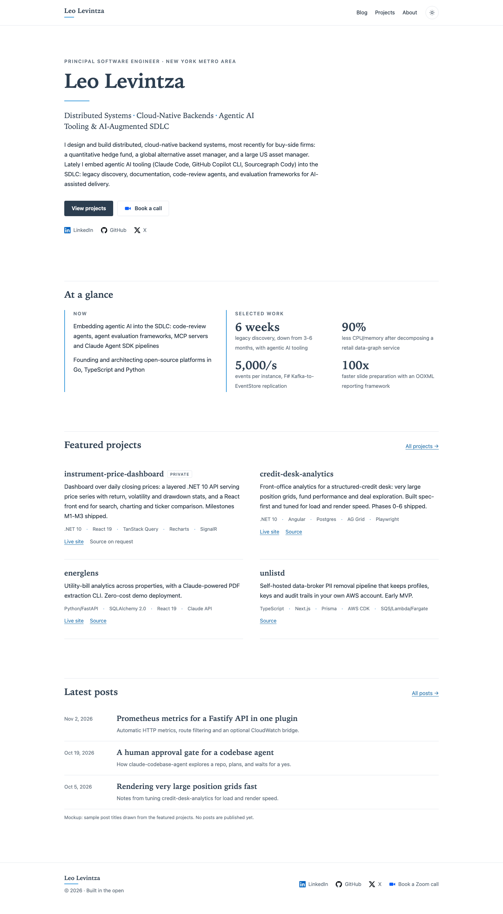
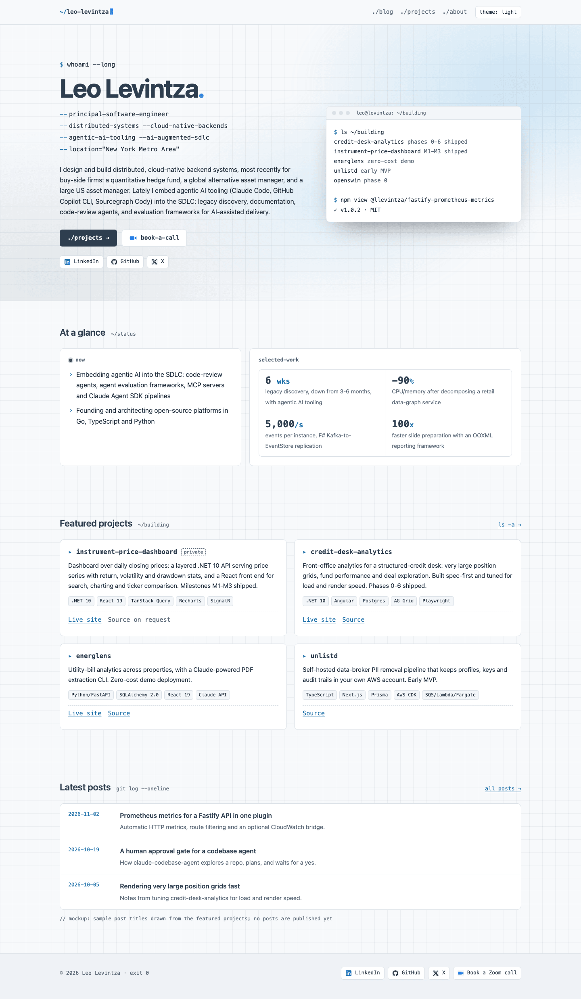
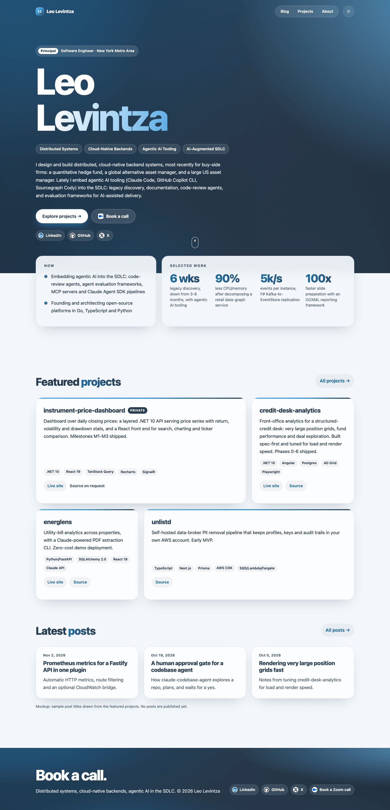

# Visual design directions (issue #41)

Three static mockups for choosing the site's look before the design system (#7, #8, #9, #12) is built. The owner picks **one**.

All three share:

- **The email-signature identity:** blue `#3498DB` (rules, borders, focus rings, large marks) and navy `rgb(44,62,80)` / `#2C3E50` (name, headings). `#3498DB` is only 3.15:1 on white, so light themes use a derived ink blue (`#1F6FA8` / `#1D6FA5`, about 5.4:1) for small link text. Every page passes axe-core WCAG 2 A/AA, colour contrast included, in both themes (see [Verify](#verify)).
- **Themes:** follow `prefers-color-scheme`. A toggle in the header overrides it, and the choice is kept in `localStorage`.
- **Reduced motion:** every animation and transition sits inside `@media (prefers-reduced-motion: no-preference)`. With reduced motion on, content renders in its final state.
- **Real content only,** taken from `index.md`, `about.md`, `_data/featured.yml`, `_config.yml` and the public repo list. There are no posts yet, so the three post titles and the sample post are drafted from the public `aws-fastify-prometheus` README and are labelled "mockup" on the page. There is no phone number and no personal email. The private `instrument-price-dashboard` appears by name only, with no repo link.
- **Contact icons** load from `https://llevintza.github.io/email-icons/img/color/` (linkedin, github, x, zoom). The GitHub and X icons are black, so dark themes put them on a light chip.
- **Plain HTML and CSS,** plus one shared vanilla script (`mockups/_shared/site.js`: theme toggle, scroll reveal, TOC highlight). No CDN, no web fonts and no build step: open any `.html` file straight from disk.

```
design/
  mockups/
    _shared/site.js
    a-signature-editorial/   home.html  post.html  projects.html  style.css
    b-engineers-console/     ...
    c-bold-gradient/         ...
  screenshots/<direction>/<page>-<390|1440>-<light|dark>.png   (36 PNGs)
  screenshot.mjs  package.json  pnpm-lock.yaml
```

## A: Signature Editorial



Light-first, calm and close to the email signature: a serif name over a thin 2px blue rule, lots of whitespace, and hairline dividers instead of boxes.

| Token | Light | Dark |
|---|---|---|
| `--bg` | `#FFFFFF` | `#0E1620` |
| `--navy` (headings) | `#2C3E50` | `#DCE6F0` |
| `--ink` (body) | `#1F2A36` | `#D5DEE7` |
| `--muted` | `#5B6B7A` (5.5:1) | `#9AA9B8` (7.6:1) |
| `--link` | `#1F6FA8` (5.4:1) | `#5DADE2` (7.4:1) |
| `--brand` (rules, borders) | `#3498DB` | `#3498DB` |
| `--line` | `#E3E8EE` | `#22303F` |
| Primary button | navy bg, white text | `#3498DB` bg, `#0B1118` text |

- **Type:** serif display (Iowan Old Style, Charter, Palatino, Georgia) over a system sans body; `ui-monospace` for code. Major-third scale (1.25) on a 17px base: 0.85, 1.0625, 1.33, 1.66, 2.07rem, and the hero at `clamp(2.4rem, 5vw + 1rem, 3.6rem)`. Body measure is 68ch.
- **Motion:** the hero rises in sequence (eyebrow, name, tagline, bio, CTAs), the blue rule draws left to right, and sections fade up 14px as they scroll in. Nothing loops.
- **Trade-offs:** the lightest of the three (13 KB of unminified CSS, no images apart from the icons, no filters or blur), so it is the fastest to paint and the easiest to keep accessible. The risk is that it looks too quiet and reads like a CV more than a builder's portfolio. Serif rendering varies by OS because there is no web font, so the build should self-host one.

## B: Engineer's Console



Dark-first and developer-native: a faint 32px grid behind everything, a slow gradient mesh in the hero, a terminal panel with live project status, monospace navigation (`./blog`), `--flag` style role lines, `git log` posts, and a file-tree TOC.

| Token | Dark (primary) | Light |
|---|---|---|
| `--bg` | `#0B1118` | `#F7F9FB` |
| `--panel` | `#111C28` | `#FFFFFF` |
| `--head` | `#F2F6FA` | `#2C3E50` |
| `--ink` | `#D5DEE7` | `#1F2A36` |
| `--muted` | `#8796A5` (6.3:1) | `#56677A` (5.4:1) |
| `--link` | `#5DADE2` | `#1D6FA5` |
| `--accent` (prompts) | `#3498DB` (6.0:1) | `#1D6FA5` |
| `--grid` | `rgba(52,152,219,.07)` | `rgba(44,62,80,.06)` |
| Mesh | `#3498DB` 35%, `#2C3E50` 85% | same hues at 10 to 22% |

- **Type:** system sans for reading; `ui-monospace` (SF Mono, JetBrains Mono, Menlo) for nav, tags, meta, prompts and metrics. Minor-third scale (1.2) on 16px: 0.8125, 1, 1.2, 1.44, 1.75rem, display `clamp(2.3rem, 4.5vw + 1rem, 4rem)` at -0.03em tracking.
- **Motion:** `whoami --long` types itself out (CSS `steps()`), then the name and role lines fade in. The brand cursor blinks, the hero mesh drifts on an 18s loop, and cards fade up as they scroll in.
- **Trade-offs:** it shows clearly who the site is for (engineers, hiring managers in tech), and the terminal panel is a natural place for live data later. Monospace text is wider, which costs line length on mobile, and heavy monospace tires readers in long posts, so post bodies stay sans. The sticky blurred header and the infinite mesh animation cost some GPU. The cursor and drift loops are disabled under reduced motion.

## C: Bold Gradient



The loudest: a full-bleed blue-to-navy gradient mesh hero (in both themes) with an 8.5rem name, pill chips, frosted-glass cards over soft colour fields, a bento grid of projects, gradient numerals and a gradient footer band.

| Token | Light | Dark |
|---|---|---|
| Mesh band | `#3498DB`, `#5DADE2`, `#2475B0`, `#2C3E50`, `#14202D`, plus a navy scrim | same |
| `--bg` | `#F3F7FB` | `#0A1220` |
| `--glass` | `rgba(255,255,255,.72)` + blur 18px | `rgba(22,36,52,.62)` + blur 18px |
| `--head` | `#2C3E50` | `#F3F7FB` |
| `--ink` | `#1C2733` | `#D7E1EA` |
| `--muted` | `#46576A` | `#9AABBC` |
| `--link` | `#1D6FA5` | `#6DB6E8` |
| `--grad-text` | `#1D6FA5 → #2C3E50` | `#8CCBF2 → #3498DB` |

- **Type:** heavy system display (SF Pro Display, Segoe UI, Inter) at weight 800 with -0.045em tracking. Perfect-fourth scale (1.333) on 17px: 0.85, 1.0625, 1.42, 1.89, 2.52rem, and the hero at `clamp(3.2rem, 9vw + .5rem, 8.5rem)`.
- **Motion:** the name rises line by line through a mask, chips pop in staggered, the mesh slowly rotates and drifts (22s loop), and a scroll hint pulses. Cards scale up as they scroll in and lift 6px on hover.
- **Trade-offs:** the most memorable and "product-like". It also costs the most. `backdrop-filter` on many cards is expensive on low-end phones, and the animated mesh repaints a large area. Text over a gradient needs a scrim to stay at AA. Glass panels that overlap the dark band had to go near-solid to pass contrast, so a future build must re-check contrast whenever the mesh changes. Gradient-clipped text needs a solid-colour fallback for forced-colours mode.

## Verify

```sh
cd design
corepack pnpm install
corepack pnpm exec playwright install chromium   # first run only
corepack pnpm screenshots                        # all 36 PNGs; add -- --only=b for one direction
corepack pnpm a11y                               # axe checks at both widths, no PNGs
```

`screenshot.mjs` opens each page over `file://` at 390x844 and 1440x900 with `colorScheme` set to light and then dark. It scrolls the page so the scroll reveals fire, waits for finite animations to finish, and takes a full-page screenshot. It also fails on:

- horizontal overflow at either width
- uncaught JS errors
- any axe-core WCAG 2 A/AA violation

PNGs are palette-quantised with `sharp`, which keeps all 36 at about 5 MB.

`design/` is a standalone pnpm project and is not part of the Jekyll build (task #3 excludes it from Jekyll).
