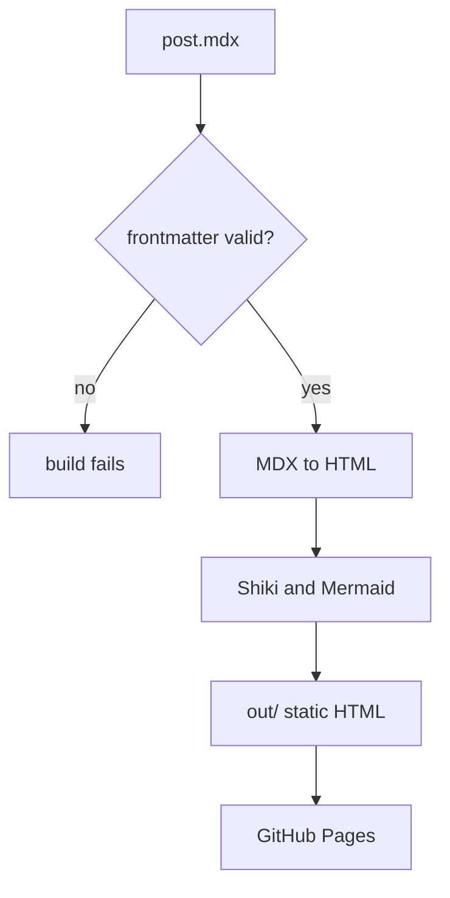

This site started as a [Jekyll](https://jekyllrb.com/) site with the minima theme, built and served by GitHub Pages. That got it online quickly, but I want more than a theme gives me: interactive pieces in posts, typed content, and a design of my own.

So I'm rebuilding it with the Next.js App Router and TypeScript in strict mode. It is still a static site: `next build` with `output: "export"` writes plain HTML files, and GitHub Pages serves them just as it served Jekyll's output.

## Posts are MDX files

Each post is an `.mdx` file in the repo, and everything about it is settled when the site builds:



Frontmatter (title, date, tags, summary) is validated with zod when the site builds, so a missing field or a malformed date fails the build instead of shipping a broken page. Code blocks are highlighted at build time with Shiki, in a light and a dark theme, so no highlighting JavaScript reaches the browser.

## Keeping the URLs

Links to the old site should keep working. Jekyll was configured with `permalink: /blog/:year/:month/:day/:title/`, and the new site builds the same shape from the post's date and file name:

```ts
interface PostParams {
  year: string;
  month: string;
  day: string;
  slug: string;
}

// 2026-11-09-rebuilding-this-site.mdx -> /blog/2026/11/09/rebuilding-this-site/
function permalinkFor({ year, month, day, slug }: PostParams): string {
  return `/blog/${year}/${month}/${day}/${slug}/`;
}
```

<Callout type="note" title="Trailing slashes">
  The export uses `trailingSlash: true`, so `/blog/` is written as
  `blog/index.html`. GitHub Pages serves that for both `/blog` and `/blog/`,
  just as it did for Jekyll.
</Callout>

## Writing richer posts

Plain Markdown covers most of what I write, but a few extras make longer posts easier to follow. All of them are rendered when the site builds, so none of them adds JavaScript to the page except image zoom.

### Callouts

A `<Callout>` sets a remark apart from the text around it, in one of three flavours:

<Callout type="tip">
  Run `pnpm build && pnpm start` to check the real static export locally before
  pushing.
</Callout>

<Callout type="warn" title="Drafts">
  A post with `draft: true` is built in development only. It never reaches the
  public site.
</Callout>

### Diagrams

Fenced `mermaid` code blocks, like the build pipeline above, are turned into SVG at build time in a light and a dark version. The page shows the one that matches the theme, and the Mermaid library itself never reaches the browser.

### Images

Images load lazily, keep their space while they load, and open full size when you select them. Press <kbd>Esc</kbd> to close.


## What's next

The Jekyll site keeps serving until the new one reaches parity. More on the design once it lands.
